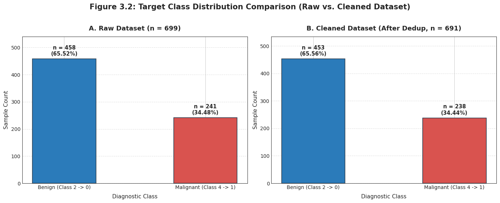
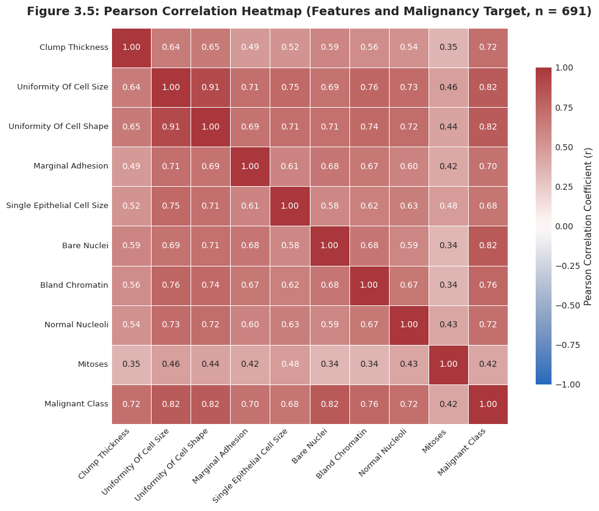
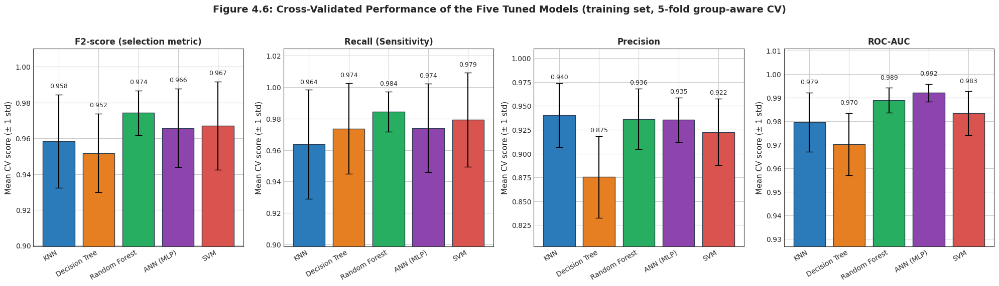
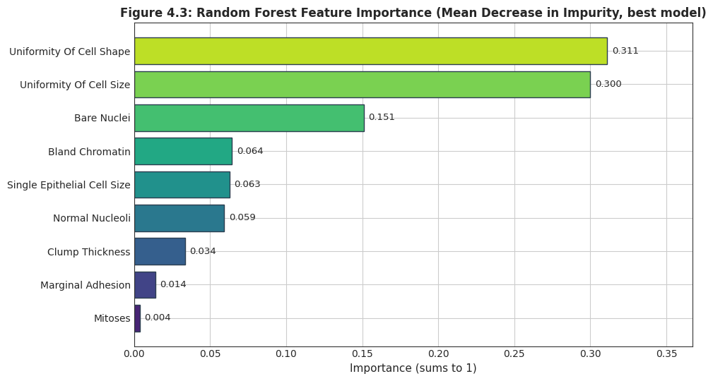
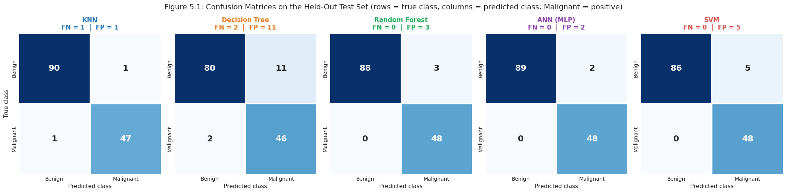
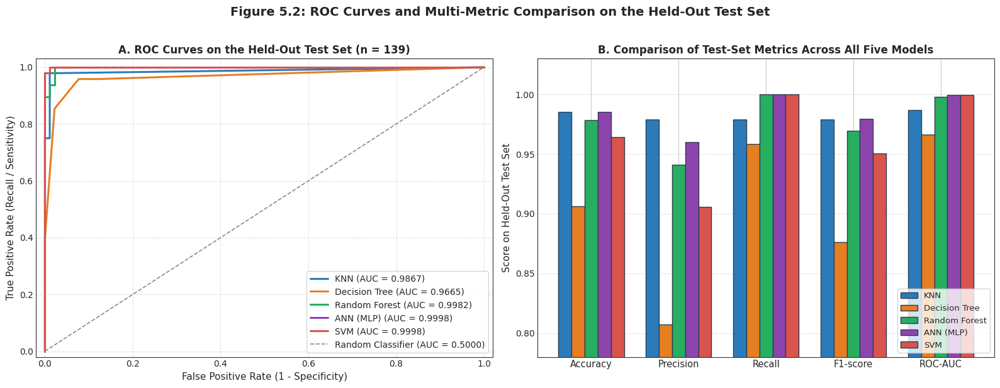

# Wisconsin Breast Cancer Classification — End-to-End Machine Learning Pipeline


%20%7C%20Recall%20100%25%20%7C%20F1%200.9796-8e44ad)

An end-to-end, leakage-free machine learning pipeline for clinical breast tumor diagnosis (**Benign** vs. **Malignant**) using Dr. William H. Wolberg's **Wisconsin Breast Cancer (Original)** cytological dataset from the UCI Machine Learning Repository (`699` raw fine-needle aspirate records, `9` ordinal cytological features scored `1–10`).

All five project phases—**Data Exploration (Task 1)**, **Data Preprocessing (Task 2)**, **Statistical Data Visualization (Task 3)**, **Model Implementation & Hyperparameter Tuning (Task 4)**, and **Held-Out Model Evaluation (Task 5)**—are unified and executed deterministically inside [`wisconsin_breast_cancer.ipynb`](wisconsin_breast_cancer.ipynb).

---

## Executive Summary & Key Highlights

| Milestone | Methodology & Key Finding |
| :--- | :--- |
| **1. Data Quality & Deduplication** | Loaded `699` raw records × `11` attributes; parsed `16` missing `?` values in `bare_nuclei` (`2.29%`) as `NaN`; removed `8` exact 11-column duplicate rows → **`691` unique records** (`453` Benign [`65.56%`], `238` Malignant [`34.44%`]). |
| **2. Zero Patient-Level Data Leakage** | Identified `46` repeated `sample_code_number` patient IDs (`92` rows with distinct cytological profiles). Used `StratifiedGroupKFold(n_splits=5, shuffle=True, random_state=42)` to partition **`552` training rows (`80%`)** and **`139` testing rows (`20%`)** with **`0` shared patient IDs**. |
| **3. In-Pipeline Preprocessing** | Encapsulated `SimpleImputer(strategy="median")` and `StandardScaler()` inside scikit-learn `Pipeline` objects so every cross-validation fold fits statistics strictly on its training subset (`n_samples_seen_ = 552`). |
| **4. Clinical Hyperparameter Tuning** | Tuned **KNN**, **Decision Tree**, **Random Forest**, **ANN (MLP)**, and **SVM** across `492` hyperparameter combinations (`2,460` CV fits) using 5-fold `StratifiedGroupKFold`, optimizing the recall-weighted **$F_2$-score ($\beta = 2$)**. |
| **5. Held-Out Test Set Winner** | Evaluated once on the isolated test set (`n = 139`: `48` Malignant, `91` Benign). **ANN (`MLPClassifier`)** achieved the best overall performance: **`Recall = 100.00%` (`0` missed cancers), `F1 = 0.9796`, `Precision = 96.00%` (`2` false alarms), `ROC-AUC = 0.9998`, `Accuracy = 98.56%`**. |

---

## Repository Structure

```text
Breast-Cancer-Wisconsin/
├── app.py                              # Interactive Streamlit Clinical Decision Support & Evaluation App
├── wisconsin_breast_cancer.ipynb       # Unified end-to-end Jupyter Notebook (Tasks 1 → 5, 123 cells)
├── README.md                           # Project documentation, methodology, and results summary
├── requirements.txt                    # Python package dependencies for reproducible execution
├── .gitignore                          # Git ignore rules for Python and Jupyter environments
├── .streamlit/
│   └── config.toml                     # Custom dark clinical theme configuration for Streamlit
├── data/
│   ├── breast-cancer-wisconsin.data    # Raw UCI dataset (699 rows × 11 columns)
│   ├── breast-cancer-wisconsin.names   # Official UCI dataset documentation & clinical metadata
│   ├── final_preprocessed_dataset.csv  # Cleaned, imputed, standardized dataset (691 rows × 10 columns)
│   └── train_test_split.csv            # Group-aware 80/20 split (552 train / 139 test) with patient IDs
├── models/
│   ├── ann_mlp_pipeline.joblib         # Tuned ANN (MLP) pipeline (Best Overall Model)
│   ├── random_forest_pipeline.joblib   # Tuned Random Forest pipeline
│   ├── svm_pipeline.joblib             # Tuned RBF-SVM pipeline
│   ├── knn_pipeline.joblib             # Tuned K-Nearest Neighbors pipeline
│   ├── decision_tree_pipeline.joblib   # Tuned Decision Tree pipeline
│   ├── cv_results_summary.csv          # 5-fold StratifiedGroupKFold cross-validation metrics (Task 4)
│   └── test_results_summary.csv        # Final held-out test set evaluation metrics & counts (Task 5)
└── figures/
    ├── fig_3_1_missing_values.png
    ├── fig_3_2_class_distribution.png
    ├── fig_3_3_feature_histograms.png
    ├── fig_3_4_feature_boxplots.png
    ├── fig_3_5_correlation_heatmap.png
    ├── fig_3_6_standardization_comparison.png
    ├── fig_4_1_knn_tuning.png
    ├── fig_4_2_dt_tuning.png
    ├── fig_4_3_rf_feature_importance.png
    ├── fig_4_4_ann_tuning.png
    ├── fig_4_5_svm_tuning.png
    ├── fig_4_6_cv_comparison.png
    ├── fig_5_1_confusion_matrices.png
    └── fig_5_2_roc_and_metrics.png
```

---

## Dataset & Clinical Features

Each sample in `data/breast-cancer-wisconsin.data` represents a fine-needle aspirate (FNA) breast biopsy evaluated across nine cytological characteristics on an integer ordinal scale from **`1` (normal/benign morphology)** to **`10` (most anaplastic/malignant morphology)**:

| Column Index | Attribute Name | Role | Scale / Encoding | Missing Values (Raw) |Pearson $r$ with Malignancy |
| :---: | :--- | :--- | :---: | :---: | :---: |
| 1 | `sample_code_number` | Patient / Sample ID (Group Key) | Integer ID | `0` | Excluded from $X$ |
| 2 | `clump_thickness` | Predictive Feature | `1 – 10` | `0` | `0.7149` ($p < 0.001$) |
| 3 | `uniformity_of_cell_size` | Predictive Feature | `1 – 10` | `0` | `0.8162` ($p < 0.001$) |
| 4 | `uniformity_of_cell_shape` | Predictive Feature | `1 – 10` | `0` | `0.8177` ($p < 0.001$) |
| 5 | `marginal_adhesion` | Predictive Feature | `1 – 10` | `0` | `0.6947` ($p < 0.001$) |
| 6 | `single_epithelial_cell_size` | Predictive Feature | `1 – 10` | `0` | `0.6810` ($p < 0.001$) |
| 7 | `bare_nuclei` | Predictive Feature | `1 – 10` | `16` (`2.29%`) | **`0.8221`** ($p < 0.001$) |
| 8 | `bland_chromatin` | Predictive Feature | `1 – 10` | `0` | `0.7568` ($p < 0.001$) |
| 9 | `normal_nucleoli` | Predictive Feature | `1 – 10` | `0` | `0.7107` ($p < 0.001$) |
| 10 | `mitoses` | Predictive Feature | `1 – 10` | `0` | `0.4227` ($p < 0.001$) |
| 11 | `class` | Diagnostic Target ($y$) | `2 → 0` (Benign), `4 → 1` (Malignant) | `0` | Target ($1.0000$) |

---

## Visual Walkthrough Across Tasks 1–5

### 1. Target Distribution & Feature Correlations (Tasks 1–3)

Removing the `8` exact duplicates preserves the class ratio at **`1.90 : 1`** (`65.56%` Benign vs. `34.44%` Malignant). Pearson correlation analysis confirms that **`bare_nuclei` ($r = 0.82$)**, **`uniformity_of_cell_shape` ($r = 0.82$)**, and **`uniformity_of_cell_size` ($r = 0.82$)** have the strongest linear associations with malignancy, while `uniformity_of_cell_size` and `uniformity_of_cell_shape` exhibit strong inter-feature collinearity ($r = 0.91$).

<p align="center">
  
</p>

<p align="center">
  
</p>

---

### 2. Cross-Validated Model Tuning & Feature Importance (Task 4)

All five classifiers were tuned exclusively on the **`552` training records** using 5-fold `StratifiedGroupKFold` and refit on the recall-weighted **$F_2$-score**:

| Model | Combinations Searched | Selected Hyperparameters | CV $F_2$ (Mean ± Std) | CV Recall | CV Precision | CV $F_1$ | CV ROC-AUC | CV Accuracy |
| :--- | :---: | :--- | :---: | :---: | :---: | :---: | :---: | :---: |
| **Random Forest** | 96 | `n_estimators=100, max_depth=None, max_features='sqrt', min_samples_leaf=3, class_weight='balanced'` | **`0.9741 ± 0.0125`** | **`0.9843 ± 0.0128`** | `0.9359 ± 0.0256` | `0.9593 ± 0.0156` | `0.9889 ± 0.0086` | `0.9710 ± 0.0112` |
| **SVM** | 72 | `kernel='rbf', C=1, gamma='scale', class_weight='balanced'` | `0.9670 ± 0.0246` | `0.9794 ± 0.0254` | `0.9219 ± 0.0459` | `0.9491 ± 0.0309` | `0.9833 ± 0.0170` | `0.9638 ± 0.0218` |
| **ANN (MLP)** | 100 | `hidden_layer_sizes=(8,), activation='relu', alpha=0.0001, learning_rate_init=0.001` | `0.9657 ± 0.0220` | `0.9739 ± 0.0235` | `0.9355 ± 0.0361` | **`0.9539 ± 0.0252`** | **`0.9920 ± 0.0046`** | **`0.9674 ± 0.0180`** |
| **KNN** | 64 | `n_neighbors=5, weights='distance', p=2` | `0.9583 ± 0.0261` | `0.9636 ± 0.0305` | **`0.9383 ± 0.0352`** | `0.9502 ± 0.0256` | `0.9795 ± 0.0195` | `0.9656 ± 0.0181` |
| **Decision Tree** | 160 | `criterion='entropy', max_depth=3, min_samples_leaf=10, class_weight='balanced'` | `0.9516 ± 0.0220` | `0.9737 ± 0.0238` | `0.8758 ± 0.0566` | `0.9209 ± 0.0320` | `0.9702 ± 0.0154` | `0.9420 ± 0.0253` |
| *Baseline (Majority)* | 1 | `strategy='most_frequent'` (Always Benign) | `0.0000 ± 0.0000` | `0.0000 ± 0.0000` | `0.0000 ± 0.0000` | `0.0000 ± 0.0000` | `0.5000 ± 0.0000` | `0.6558 ± 0.0020` |

<p align="center">
  
</p>

<p align="center">
  
</p>

---

### 3. Held-Out Test Set Evaluation & Best Overall Model (Task 5)

Each saved pipeline was evaluated **once** on the untouched held-out test partition (**`n = 139` records**: `48` Malignant [positive class = `1`] and `91` Benign [negative class = `0`]):

| Final Rank | Model | Test Recall (Sensitivity) | Test F1-Score | Test Precision | Test ROC-AUC | Test Accuracy | TP | TN | FP (False Alarms) | FN (Missed Cancers) | Total Errors |
| :---: | :--- | :---: | :---: | :---: | :---: | :---: | :---: | :---: | :---: | :---: | :---: |
| **1 (Best)** | **ANN (MLP)** | **`1.0000`** | **`0.9796`** | `0.9600` | **`0.9998`** | **`0.9856`** | **48** | **89** | **2** | **0** | **2** |
| **2** | **Random Forest** | **`1.0000`** | `0.9697` | `0.9412` | `0.9982` | `0.9784` | 48 | 88 | 3 | **0** | 3 |
| **3** | **SVM** | **`1.0000`** | `0.9505` | `0.9057` | **`0.9998`** | `0.9640` | 48 | 86 | 5 | **0** | 5 |
| **4** | **KNN** | `0.9792` | `0.9792` | **`0.9792`** | `0.9867` | **`0.9856`** | 47 | **90** | **1** | 1 | **2** |
| **5** | **Decision Tree** | `0.9583` | `0.8762` | `0.8070` | `0.9665` | `0.9065` | 46 | 80 | 11 | 2 | 13 |

<p align="center">
  
</p>

<p align="center">
  
</p>

#### Why **ANN (MLP)** is Selected as the Best Overall Model:
1. **Zero Missed Cancers (`Recall = 1.0000`, `FN = 0 / 48`):** In clinical oncology screening, a False Negative (`FN`) delays life-saving treatment. ANN, Random Forest, and SVM all detected 100% of malignant tumors on the test set, whereas KNN (`FN = 1`) and Decision Tree (`FN = 2`) missed malignant cases.
2. **Highest Precision & F1-Score Among Zero-FN Models (`Precision = 96.00%`, `F1 = 0.9796`):** Among the three models achieving 100% Recall, ANN produced the fewest false alarms (`FP = 2` benign cases referred for follow-up vs. `3` for Random Forest and `5` for SVM).
3. **Top Overall Accuracy (`98.56%`) & Threshold-Independent Separability (`ROC-AUC = 0.9998`):** ANN tied for the highest overall accuracy (`137 / 139` correct predictions) and tied with SVM for the highest ROC-AUC (`0.9998`), using a compact single-hidden-layer network (`8` ReLU units, `89` total parameters) that generalizes smoothly without overfitting.

---

## Quickstart & Reproducibility

### 1. Clone the Repository & Install Dependencies
```bash
git clone https://github.com/M7moudeGalal/Breast-Cancer-Wisconsin.git
cd Breast-Cancer-Wisconsin
pip install -r requirements.txt
```

### 2. Launch the Interactive Clinical Streamlit Web App (`app.py`)
Run the interactive clinical decision support dashboard locally:
```bash
streamlit run app.py
```
- **Live Clinical Diagnosis & 5-Model Consensus:** Adjust the 9 cytological sliders (`1–10`), simulate missing `bare_nuclei` (`NaN`), or pick held-out test presets to see live predictions and probabilities across all 5 tuned pipelines (`ANN (MLP)`, `Random Forest`, `SVM`, `KNN`, `Decision Tree`).
- **Interactive Evaluation & EDA Tabs:** Browse Task 5 test-set benchmarks, Task 4 CV tuning curves, and Tasks 1–3 exploratory charts.

### 3. Launch or Re-Execute the Unified Notebook
Open `wisconsin_breast_cancer.ipynb` in Jupyter Notebook, JupyterLab, or VS Code:
```bash
jupyter notebook wisconsin_breast_cancer.ipynb
```
Or execute the entire pipeline headlessly from the command line:
```bash
jupyter nbconvert --to notebook --execute --inplace wisconsin_breast_cancer.ipynb
```


